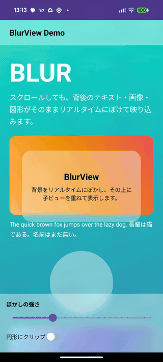
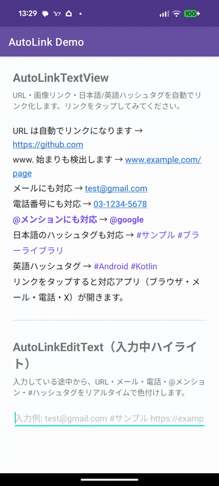

# Blur & AutoLink Sample

Android 向けの 2 つの UI ライブラリと、その使い方を示すサンプルアプリをまとめたリポジトリです。

| モジュール | 内容 |
| --- | --- |
| **`blurlib`** (`com.firmapp.blur`) | 背後のビューをリアルタイムにぼかす「すりガラス」。`RenderEffect` ベース。**View 版 (`BlurView`) と Compose 版 (`Modifier.backdropBlur`) の両方を同梱**し、ぼかしエンジン (`BackdropBlurRenderer`) を共有。 |
| **`autolinklib`** (`com.firmapp.autolink`) | 本文中の URL・メール・電話・@メンション・#ハッシュタグを自動リンク化する `TextView`。 |
| **`app`** | 両ライブラリを組み込んだデモアプリ。 |

## デモ

| blurlib — スクロール追従のリアルタイムぼかし | autolinklib — 自動リンク化 & 入力中ハイライト |
| :---: | :---: |
|  |  |
| 背景（テキスト・画像・図形）をスクロールしても、ヘッダー／カード／パネルの「すりガラス」がリアルタイムに追従してぼかす | 本文の URL・メール・電話・@メンション・#ハッシュタグを自動リンク化。入力欄では入力中にハイライトし、確定でタップ可能なリンクに切り替わる |

## 必要環境

- Android Studio / AGP 8.2.x・Gradle 8.5
- JDK 17（Gradle 実行用。Android Studio の Gradle JDK も 17 に設定）
- `minSdk 31`（`blurlib` が `RenderEffect` を使うため）/ `compileSdk 34`
- Kotlin 1.9.x / Compose Compiler 1.5.10・Compose BOM 2024.02.01

## ビルドと実行

```bash
./gradlew :app:installDebug
```

ホーム画面の 3 つのボタン（BlurView / BlurView Compose / AutoLink）から、それぞれのデモ画面へ遷移します。

## blurlib — すりガラス

非推奨の RenderScript を使わず、`RenderNode` + `RenderEffect`（API 31+）で背景の
スナップショットにハードウェアぼかしを適用します。**背景がスクロールしても、ぼかしが
リアルタイムに追従する**のが特徴です（毎フレーム背景を取り込み直す方式）。

View 版・Compose 版とも、ぼかしエンジン `BackdropBlurRenderer` を共有しています。

### View 版（`BlurView`）

```kotlin
blurView.blurBehind(backgroundView)   // ぼかし元のビューを指定
blurView.blurRadiusDp = 20f
blurView.cornerRadiusDp = 16f         // 角丸
blurView.circle = true                // 円形クリップ
blurView.overlayColor = 0x55FFFFFF    // 重ねる色
```

XML 属性: `blurRadius` / `blurOverlayColor` / `blurCornerRadius` / `blurCircle` / `blurDownscale`

> ⚠️ `blurBehind()` に渡すビューは、その `BlurView` を**子孫に含めない**でください（描画が再帰します）。
>
> ⚠️ スクロールする背景をぼかす場合は、スクロールコンテナ（`ScrollView` など）ではなく
> **実際に移動する中身のビュー**を渡してください。コンテナを直接 `draw()` すると描画が
> スクロール位置とずれることがあります。

### Compose 版（`Modifier.backdropBlur`）

```kotlin
val state = rememberBackdropBlurState()

Box {
    // ぼかし元: 実際にスクロールする中身に backdropSource を付ける
    Column(
        Modifier
            .verticalScroll(rememberScrollState())
            .backdropSource(state),
    ) {
        // テキスト・画像・図形など
    }

    // すりガラスのパネル/カード/ヘッダー
    Box(
        Modifier
            .align(Alignment.Center)
            .size(300.dp, 180.dp)
            .backdropBlur(
                state,
                radius = 20.dp,
                overlayColor = Color(0x55FFFFFF),
                shape = RoundedCornerShape(24.dp), // 円なら CircleShape
            ),
    ) {
        // パネル上に重ねる中身
    }
}
```

同じ `state` を複数の `backdropBlur`（ヘッダー・カード・ボトムパネル等）で共有できます。

## autolinklib — 自動リンク

### 確定テキスト用（`AutoLinkTextView`）

```kotlin
autoLinkTextView.linkTypes = setOf(LinkType.Web, LinkType.Mention, LinkType.Hashtag)
autoLinkTextView.transformUrl { url -> url.removePrefix("https://") }  // 表示の短縮など
autoLinkTextView.text = "……"

// タップ時の挙動をカスタムしたい場合のみ指定(未指定なら既定アクションが起動)
autoLinkTextView.onLinkClick { link -> /* link.type / link.rawText / link.text */ }
```

**タップ時の既定アクション**: `onLinkClick` を設定しない場合、種別に応じて自動でアプリを起動します
（`LinkActions` 経由）。

| 種別 | 起動 |
| --- | --- |
| `Web` | ブラウザ（`ACTION_VIEW`。`www.` には `https://` を補完） |
| `Email` | メールアプリ（`mailto:`） |
| `Phone` | 電話アプリ（`tel:`。`ACTION_DIAL`なので発信はユーザー操作） |
| `Mention` | X のプロフィール（`https://x.com/<user>`） |
| `Hashtag` | X のハッシュタグ検索（`https://x.com/hashtag/<tag>`） |

`LinkActions.intentFor(link)` / `LinkActions.open(context, link)` を直接呼ぶこともできます。

### Compose 版（`AutoLinkText`）

`AutoLinkTextView` の Compose 版。検出は View 版と共通の `LinkDetector`、タップの既定動作は
`LinkActions`（未指定時）。

```kotlin
AutoLinkText(
    text = "……",
    linkTypes = setOf(LinkType.Web, LinkType.Email, LinkType.Mention, LinkType.Hashtag),
    style = TextStyle(fontSize = 16.sp, color = MaterialTheme.colorScheme.onSurface),
    // onLinkClick 未指定なら LinkActions でアプリ起動。独自処理したいときだけ指定:
    // onLinkClick = { link -> /* link.type / link.rawText */ },
)
```

- 内部で `AnnotatedString`（`SpanStyle` ＋ クリック注釈）を組み立て、`ClickableText` で描画。

入力欄版は **`AutoLinkTextField`**（`AutoLinkEditText` の Compose 版）。編集中は `VisualTransformation`
でリアルタイム色付け、確定(`ImeAction.Done`)で同じ欄をタップ可能なリンク表示に切り替え、リンク以外を
タップすると編集へ戻ります。

```kotlin
var value by remember { mutableStateOf(TextFieldValue()) }
AutoLinkTextField(
    value = value,
    onValueChange = { value = it },
    linkTypes = setOf(LinkType.Web, LinkType.Email, LinkType.Hashtag),
    textStyle = TextStyle(fontSize = 16.sp),
    placeholder = { Text("入力例: …") },
)
```

### 入力中ハイライト用（`AutoLinkEditText`）

入力している最中にリアルタイムで色付けする `EditText`。`AutoLinkTextView` と同じ `linkTypes` /
`setLinkStyle()` を持ちます。

```kotlin
autoLinkEditText.linkTypes = setOf(LinkType.Web, LinkType.Email, LinkType.Mention, LinkType.Hashtag)
autoLinkEditText.setLinkStyle(LinkType.Hashtag, LinkStyle(Color.MAGENTA, bold = true))

// 確定(Enter)で同じ欄をリンクのタップ表示へ切り替える
autoLinkEditText.setOnEditorActionListener { _, id, _ ->
    if (id == EditorInfo.IME_ACTION_DONE) { autoLinkEditText.showLinks = true; true } else false
}
```

- `TextWatcher` で変更のたびに `LinkDetector`（`AutoLinkTextView` と共通の検出エンジン）を実行し、
  自前の色スパンのみ付け替えるため IME の変換装飾を壊しません。
- **`showLinks`**: `true` で同じ欄のまま読み取り専用のタップ可能リンク表示に切り替わり、
  リンクをタップすると種別ごとのアプリ（`LinkActions`）が起動します。リンク以外をタップすると
  自動で編集モードに戻ります（別の表示用ビューは不要）。

### 共通

- 種別は `sealed interface LinkType`（`Web` / `Email` / `Phone` / `Mention` / `Hashtag` / `Custom`）。
- ハッシュタグ・メンションは Unicode プロパティ `\p{L}` を使うため **日本語などマルチバイト文字に対応**。
- 見た目は `setLinkStyle(type, LinkStyle(...))` で種別ごとに設定可能。

## ライセンス

[MIT License](LICENSE) © firm-app
